<!-- 标记（posts）之间由 scripts/build.mjs 生成，GitHub Actions 每天刷新；带 signal.elvhack.com 的图片由 worker/ 实时生成；其余部分可以直接改。 -->

<a href="https://elvhack.com">elvhack.com</a> &nbsp;·&nbsp; <a href="https://elvhack.com/lab/">lab</a> &nbsp;·&nbsp; <a href="https://x.com/elvhack">x</a> &nbsp;·&nbsp; <a href="https://www.tiktok.com/@elvhack">tiktok</a> &nbsp;·&nbsp; <a href="https://elvhack.com/rss.xml">rss</a>

 

一幅大家一起画的画。点一下放上一段碎片；拼满一朵，下一朵换一个 k 重新开始。

 

走进迷宫。漂浮的节点是我的项目，走到 core 算一次。位置是所有来访的人共享的。

 

抽一件独一无二的生成艺术：多面体、环面结、三维李萨如、玫瑰曲线。越稀有越复杂。

 

 

NOTES 
<!-- posts:start -->
<a href="https://elvhack.com/posts/ascii-shader/">把 ASCII 着色器提速 169 倍</a> 2026.10.16 
<a href="https://elvhack.com/posts/sidenotes/">在网页上做 Tufte 式旁注</a> 2026.10.16 
<a href="https://elvhack.com/posts/generative-covers/">每篇文章一张生成封面</a> 2026.10.16 
<a href="https://elvhack.com/posts/hello-world/">重新开始</a> 2026.10.16 
<!-- posts:end -->

每张图都是代码生成的 SVG：<a href="scripts/">scripts/</a> · <a href="worker/src/index.js">worker/</a>

