<!-- 标记（posts）之间的文章列表和 assets/ 里的图（每张有深色和 -light 两版）都由 scripts/build.mjs 生成，GitHub Actions 每天刷新；其余部分可以直接改。 -->

<a href="https://elvhack.com"><picture><source media="(prefers-color-scheme: light)" srcset="assets/header-light.svg"></picture></a>

<a href="https://elvhack.com">elvhack.com</a> &nbsp;·&nbsp; <a href="https://elvhack.com/lab/">lab</a> &nbsp;·&nbsp; <a href="https://x.com/elvhack">x</a> &nbsp;·&nbsp; <a href="https://www.tiktok.com/@elvhack">tiktok</a> &nbsp;·&nbsp; <a href="https://elvhack.com/rss.xml">rss</a>

 

<picture><source media="(prefers-color-scheme: light)" srcset="assets/rose-light.svg"></picture>

 

<picture><source media="(prefers-color-scheme: light)" srcset="assets/sonar-light.svg"></picture>

 

<picture><source media="(prefers-color-scheme: light)" srcset="assets/singularity-light.svg"></picture>

 

NOTES 
<!-- posts:start -->
<a href="https://elvhack.com/posts/ascii-shader/">把 ASCII 着色器提速 169 倍</a> 2026.10.16 
<a href="https://elvhack.com/posts/sidenotes/">在网页上做 Tufte 式旁注</a> 2026.10.16 
<a href="https://elvhack.com/posts/generative-covers/">每篇文章一张生成封面</a> 2026.10.16 
<a href="https://elvhack.com/posts/hello-world/">重新开始</a> 2026.10.16 
<!-- posts:end -->

III · after key art © Konami Digital Entertainment

