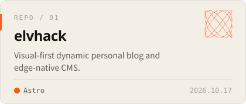
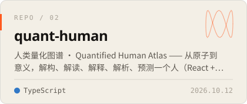
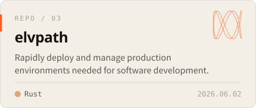
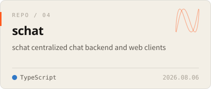

<!-- 标记（posts / repos / activity）之间的内容由 scripts/build.mjs 生成，GitHub Actions 每天刷新；其余部分可以直接改。 -->

<a href="https://elvhack.com"><picture><source media="(prefers-color-scheme: dark)" srcset="assets/header-dark.svg"></picture></a>

  <a href="https://elvhack.com"><b>elvhack.com</b></a> &nbsp;·&nbsp;
  <a href="https://elvhack.com/posts/">文章</a> &nbsp;·&nbsp;
  <a href="https://elvhack.com/lab/">实验室</a> &nbsp;·&nbsp;
  <a href="https://elvhack.com/rss.xml">RSS</a> &nbsp;·&nbsp;
  <a href="https://x.com/elvhack">X</a> &nbsp;·&nbsp;
  <a href="https://www.tiktok.com/@elvhack">TikTok</a>

### `01` 关于

写代码，也做视觉。[elvhack.com](https://elvhack.com) 是我的个人实验室：写下做过的东西，留下能玩的实验。

- 兴趣：WebGL 与生成艺术 · 量化 · 全栈工程 · Rust
- 能玩的实验：[`EXP-01` 流场](https://elvhack.com/lab/flow-field/) · [`EXP-02` 莫尔纹](https://elvhack.com/lab/moire/) · [`EXP-03` 山脊线](https://elvhack.com/lab/ridgelines/) · [`EXP-04` 双正弦示波器](https://elvhack.com/lab/signal-scope/)

### `02` 最近写的

<!-- posts:start -->
- `2026.10.16` **[把 ASCII 着色器提速 169 倍](https://elvhack.com/posts/ascii-shader/)** 首页的字符矩阵最初每个像素都要算一遍噪声。换成两遍渲染——先按字符格算，再按像素查表——计算量降到原来的 1/169。
- `2026.10.16` **[在网页上做 Tufte 式旁注](https://elvhack.com/posts/sidenotes/)** 宽屏时把脚注挪到正文右侧的页边，和正文里的标号对齐；窄屏退回文末脚注；读屏器始终读到原来的脚注。
- `2026.10.16` **[每篇文章一张生成封面](https://elvhack.com/posts/generative-covers/)** 不画图、不传图：用文章 id 的哈希驱动四种生成艺术，构建时输出 SVG，再靠 &lt;use&gt; 继承颜色，让同一张封面同时适配明暗主题。
- `2026.10.16` **[重新开始](https://elvhack.com/posts/hello-world/)** 旧站全部清空，从零重建。顺便演示这个博客能写什么：Markdown、代码、脚注，以及可以直接在页面里玩的交互实验。

→ 全部文章在 [elvhack.com/posts](https://elvhack.com/posts/)，也可以 [订阅 RSS](https://elvhack.com/rss.xml)。
<!-- posts:end -->

### `03` 在做的

<!-- repos:start -->
<a href="https://github.com/elv-hack/elvhack"><picture><source media="(prefers-color-scheme: dark)" srcset="assets/repo-elvhack-dark.svg"></picture></a>&nbsp;<a href="https://github.com/elv-hack/quant-human"><picture><source media="(prefers-color-scheme: dark)" srcset="assets/repo-quant-human-dark.svg"></picture></a>
<a href="https://github.com/elv-hack/elvpath"><picture><source media="(prefers-color-scheme: dark)" srcset="assets/repo-elvpath-dark.svg"></picture></a>&nbsp;<a href="https://github.com/elv-hack/schat"><picture><source media="(prefers-color-scheme: dark)" srcset="assets/repo-schat-dark.svg"></picture></a>
<!-- repos:end -->

### `04` 信号

<!-- activity:start -->
<a href="https://github.com/elv-hack"><picture><source media="(prefers-color-scheme: dark)" srcset="assets/activity-dark.svg"></picture></a>
<!-- activity:end -->

头图、卡片和信号图都是 <a href="scripts/build.mjs">scripts/build.mjs</a> 生成的 SVG，样式和博客同源。

