<!-- 标记（posts / channels / intercepts）之间由 scripts/build.mjs 生成，GitHub Actions 每天刷新；SIGNAL DECK 的图片由 worker/ 实时生成；其余部分可以直接改。 -->

<a href="https://elvhack.com"><picture><source media="(prefers-color-scheme: dark)" srcset="assets/header-dark.svg"></picture></a>

  <a href="https://elvhack.com"><code>ELVHACK.COM ↗</code></a>&nbsp;
  <a href="https://elvhack.com/lab/"><code>LAB ↗</code></a>&nbsp;
  <a href="https://x.com/elvhack"><code>X ↗</code></a>&nbsp;
  <a href="https://www.tiktok.com/@elvhack"><code>TIKTOK ↗</code></a>&nbsp;
  <a href="https://elvhack.com/rss.xml"><code>RSS ↗</code></a>

### SIGNAL DECK

<a href="https://elvhack.com"><picture><source media="(prefers-color-scheme: dark)" srcset="https://signal.elvhack.com/feed.svg?theme=dark"></picture></a>

<a href="https://signal.elvhack.com/deck/ping"><picture><source media="(prefers-color-scheme: dark)" srcset="https://signal.elvhack.com/button/ping.svg?theme=dark"></picture></a><a href="https://signal.elvhack.com/deck/scan"><picture><source media="(prefers-color-scheme: dark)" srcset="https://signal.elvhack.com/button/scan.svg?theme=dark"></picture></a><a href="https://signal.elvhack.com/deck/decrypt"><picture><source media="(prefers-color-scheme: dark)" srcset="https://signal.elvhack.com/button/decrypt.svg?theme=dark"></picture></a><a href="https://signal.elvhack.com/deck/trace"><picture><source media="(prefers-color-scheme: dark)" srcset="https://signal.elvhack.com/button/trace.svg?theme=dark"></picture></a>

↑ 点一个按钮发出信号，回到这里就能在日志里看到它。只记录国家/地区代码，不记录 IP。

### CHANNELS

<!-- channels:start -->
<a href="https://github.com/elv-hack/quantcore"><picture><source media="(prefers-color-scheme: dark)" srcset="assets/channel-quant-dark.svg"></picture></a>&nbsp;<a href="https://github.com/elv-hack/Z3r0"><picture><source media="(prefers-color-scheme: dark)" srcset="assets/channel-sec-dark.svg"></picture></a>
<a href="https://github.com/elv-hack/elvhack"><picture><source media="(prefers-color-scheme: dark)" srcset="assets/channel-dev-dark.svg"></picture></a>&nbsp;<a href="https://github.com/elv-hack/nexus"><picture><source media="(prefers-color-scheme: dark)" srcset="assets/channel-intel-dark.svg"></picture></a>
<!-- channels:end -->

<code>▸ DECRYPT</code> <b>whoami</b>

 

写代码，也做视觉。[elvhack.com](https://elvhack.com) 是我的个人实验室：写下做过的东西，留下能玩的实验。

| | |
|:--|:--|
| `QUANT` | 量化 |
| `SEC` | 授权渗透测试与漏洞研究 |
| `DEV` | 全栈、WebGL、生成艺术 |
| `INTEL` | 基于公开来源的情报分析 |

<code>▸ DECRYPT</code> <b>lab — 能玩的实验</b>

 

| | | |
|:--|:--|:--|
| `EXP-01` | [流场](https://elvhack.com/lab/flow-field/) | 上千个粒子沿着噪声场流动，指针附近会形成涡旋 |
| `EXP-02` | [莫尔纹](https://elvhack.com/lab/moire/) | 两组规则图案稍微错开，干涉出第三种图案 |
| `EXP-03` | [山脊线](https://elvhack.com/lab/ridgelines/) | 致敬《Unknown Pleasures》的脉冲星信号 |
| `EXP-04` | [双正弦示波器](https://elvhack.com/lab/signal-scope/) | 两路正弦的叠加与李萨如图形 |

### TRANSMISSIONS

<!-- posts:start -->
- `TX/004` **[把 ASCII 着色器提速 169 倍](https://elvhack.com/posts/ascii-shader/)** `2026.10.16` 首页的字符矩阵最初每个像素都要算一遍噪声。换成两遍渲染——先按字符格算，再按像素查表——计算量降到原来的 1/169。
- `TX/003` **[在网页上做 Tufte 式旁注](https://elvhack.com/posts/sidenotes/)** `2026.10.16` 宽屏时把脚注挪到正文右侧的页边，和正文里的标号对齐；窄屏退回文末脚注；读屏器始终读到原来的脚注。
- `TX/002` **[每篇文章一张生成封面](https://elvhack.com/posts/generative-covers/)** `2026.10.16` 不画图、不传图：用文章 id 的哈希驱动四种生成艺术，构建时输出 SVG，再靠 &lt;use&gt; 继承颜色，让同一张封面同时适配明暗主题。
- `TX/001` **[重新开始](https://elvhack.com/posts/hello-world/)** `2026.10.16` 旧站全部清空，从零重建。顺便演示这个博客能写什么：Markdown、代码、脚注，以及可以直接在页面里玩的交互实验。

全部文章 → [elvhack.com/posts](https://elvhack.com/posts/) · [RSS](https://elvhack.com/rss.xml)
<!-- posts:end -->

### INTERCEPTS

<!-- intercepts:start -->
<a href="https://github.com/elv-hack"><picture><source media="(prefers-color-scheme: dark)" srcset="assets/intercepts-dark.svg"></picture></a>
<!-- intercepts:end -->

<code>EOF</code> · 头图、卷宗和波形由 <a href="scripts/build.mjs">scripts/build.mjs</a> 生成，信号台由 <a href="worker/src/index.js">worker/</a> 实时生成

