<!-- 标记（posts / broadcast / staff）之间由 scripts/build.mjs 生成，GitHub Actions 每天刷新；看板娘、抽卡、通信日志和按钮由 worker/ 实时生成；其余部分可以直接改。 -->

<a href="https://elvhack.com"><picture><source media="(prefers-color-scheme: dark)" srcset="assets/opening-dark.svg"></picture></a>

  <a href="https://elvhack.com"><code>ELVHACK.COM ↗</code></a>&nbsp;
  <a href="https://elvhack.com/lab/"><code>LAB ↗</code></a>&nbsp;
  <a href="https://x.com/elvhack"><code>X ↗</code></a>&nbsp;
  <a href="https://www.tiktok.com/@elvhack"><code>TIKTOK ↗</code></a>&nbsp;
  <a href="https://elvhack.com/rss.xml"><code>RSS ↗</code></a>

### 看板娘エルヴ

<a href="https://signal.elvhack.com/"><picture><source media="(prefers-color-scheme: dark)" srcset="https://signal.elvhack.com/stage.svg?theme=dark"></picture></a>

<a href="https://signal.elvhack.com/pet/milktea"><picture><source media="(prefers-color-scheme: dark)" srcset="https://signal.elvhack.com/button/milktea.svg?theme=dark"></picture></a><a href="https://signal.elvhack.com/pet/headpat"><picture><source media="(prefers-color-scheme: dark)" srcset="https://signal.elvhack.com/button/headpat.svg?theme=dark"></picture></a><a href="https://signal.elvhack.com/pet/poke"><picture><source media="(prefers-color-scheme: dark)" srcset="https://signal.elvhack.com/button/poke.svg?theme=dark"></picture></a>

点一下按钮会经过 signal.elvhack.com 记一笔，然后自动回到这里。好感度是所有来访的人一起攒的。

### ガチャ

<a href="https://signal.elvhack.com/"><picture><source media="(prefers-color-scheme: dark)" srcset="https://signal.elvhack.com/gacha.svg?theme=dark"></picture></a>

<a href="https://signal.elvhack.com/gacha/pull"><picture><source media="(prefers-color-scheme: dark)" srcset="https://signal.elvhack.com/button/pull.svg?theme=dark"></picture></a>

<picture><source media="(prefers-color-scheme: dark)" srcset="https://signal.elvhack.com/collection.svg?theme=dark"></picture>

出货率 SSR 3% · SR 17% · R 80%。抽到的卡会出现在上面，图鉴是全站一起点亮的。

### 通信ログ

<a href="https://elvhack.com"><picture><source media="(prefers-color-scheme: dark)" srcset="https://signal.elvhack.com/feed.svg?theme=dark"></picture></a>

<a href="https://signal.elvhack.com/deck/ping"><picture><source media="(prefers-color-scheme: dark)" srcset="https://signal.elvhack.com/button/ping.svg?theme=dark"></picture></a><a href="https://signal.elvhack.com/deck/scan"><picture><source media="(prefers-color-scheme: dark)" srcset="https://signal.elvhack.com/button/scan.svg?theme=dark"></picture></a><a href="https://signal.elvhack.com/deck/decrypt"><picture><source media="(prefers-color-scheme: dark)" srcset="https://signal.elvhack.com/button/decrypt.svg?theme=dark"></picture></a><a href="https://signal.elvhack.com/deck/trace"><picture><source media="(prefers-color-scheme: dark)" srcset="https://signal.elvhack.com/button/trace.svg?theme=dark"></picture></a>

### 次回予告

<!-- posts:start -->
> **次回、第4話「[把 ASCII 着色器提速 169 倍](https://elvhack.com/posts/ascii-shader/)」。** お楽しみに！ 首页的字符矩阵最初每个像素都要算一遍噪声。换成两遍渲染——先按字符格算，再按像素查表——计算量降到原来的 1/169。

- `第3話` [在网页上做 Tufte 式旁注](https://elvhack.com/posts/sidenotes/) 2026.10.16
- `第2話` [每篇文章一张生成封面](https://elvhack.com/posts/generative-covers/) 2026.10.16
- `第1話` [重新开始](https://elvhack.com/posts/hello-world/) 2026.10.16

全部剧集 → [elvhack.com/posts](https://elvhack.com/posts/) · [RSS](https://elvhack.com/rss.xml)
<!-- posts:end -->

### 放送記録

<!-- broadcast:start -->
<a href="https://github.com/elv-hack"><picture><source media="(prefers-color-scheme: dark)" srcset="assets/broadcast-dark.svg"></picture></a>
<!-- broadcast:end -->

<b>キャラクター紹介</b>　エルヴ

 

| | |
|:--|:--|
| 名前 | エルヴ（Elv） |
| 职业 | 信号接线员，elvhack.com 的看板娘 |
| 喜欢 | 奶茶、夕焼け、city pop、凌晨两点的显示器 |
| 讨厌 | 早起、没有注释的代码 |
| 天线 | 收到信号会亮。戳她的时候也会亮 |
| 中の人 | [elvhack](https://elvhack.com) —— `QUANT` · `SEC` · `DEV` · `INTEL` |

<a href="https://elvhack.com"><picture><source media="(prefers-color-scheme: dark)" srcset="assets/ending-dark.svg"></picture></a>

<!-- staff:start -->

STAFF：<a href="https://github.com/elv-hack/elvhack">elvhack</a> · <a href="https://github.com/elv-hack/quantcore">quantcore</a> · <a href="https://github.com/elv-hack/Z3r0">Z3r0</a> · <a href="https://github.com/elv-hack/nexus">nexus</a>

<!-- staff:end -->

片头、片尾和放送记录由 <a href="scripts/build.mjs">scripts/build.mjs</a> 生成；看板娘、抽卡和通信日志由 <a href="worker/src/index.js">worker/</a> 实时生成。人物和卡面都是原创。

